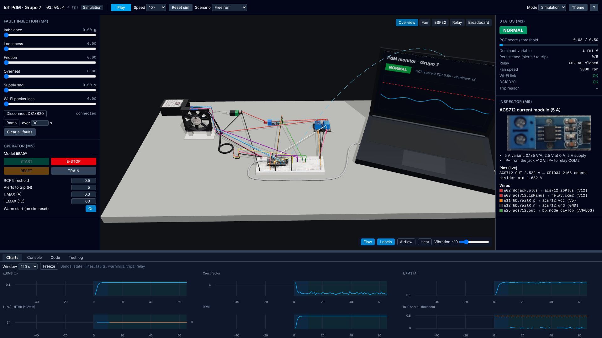
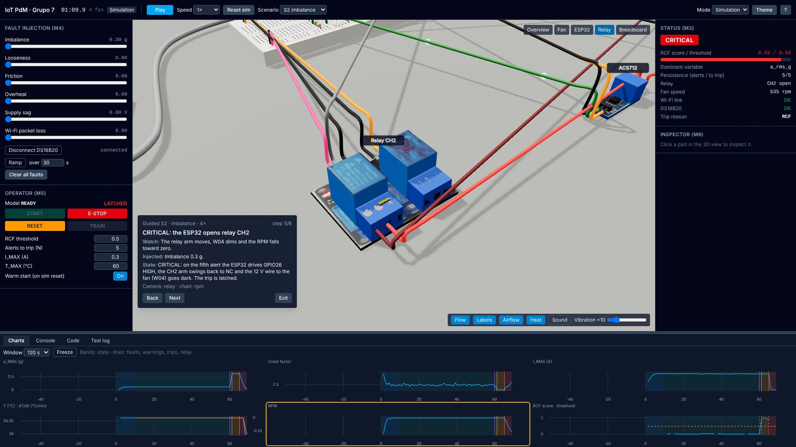
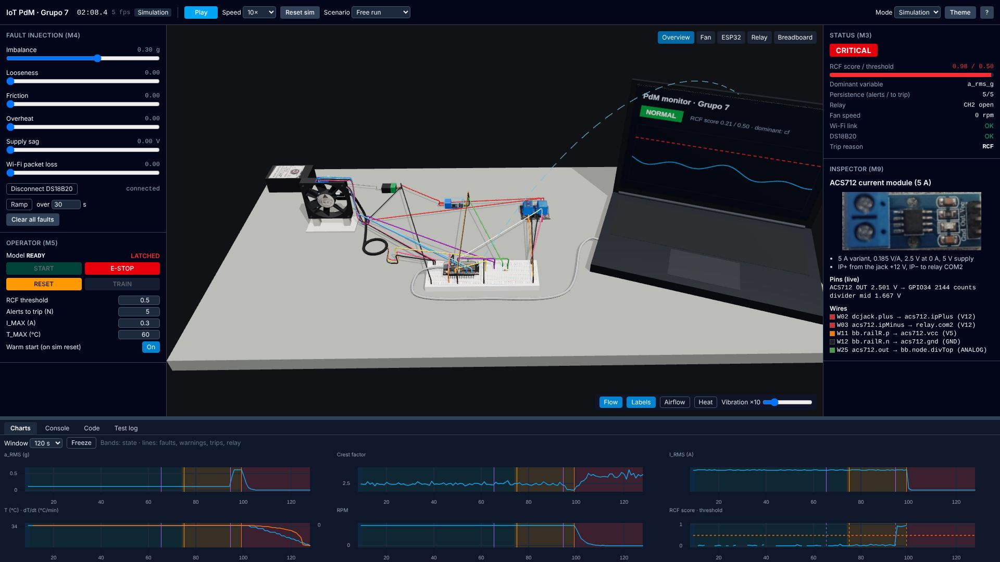

# IoT predictive-maintenance 3D simulator

A browser simulator of Grupo 7's bench for UTEC CS5055 (IoT), 2026-2. A 12 V Delta AFB0712HB fan is monitored by an
MPU6050 (vibration), an ACS712 (current) and a DS18B20 (temperature) on an ESP32. Every second the ESP32 sends a
feature packet over Wi-Fi to a laptop. There a Robust Random Cut Forest (RCF) scores it and sends back a verdict.
When the anomaly persists, the ESP32 opens relay CH2 and cuts the fan's 12 V.

**Live:** https://creeplyndarker.github.io/3D-SIMULATOR-IOT/

## What it shows

- **The real bench in 3D:** every part, wire and pin of the team's breadboard, with the fan, the relay and the
  Wi-Fi link animated from the simulation. Power nets glow, data pulses follow real traffic, and the 12 V wire to
  the fan goes dark when CH2 opens.
- **The whole chain, running live:**
  - **Plant:** fan, heat and sensors at 2 kHz.
  - **ESP32 firmware mirror:** 1 kHz sampling, 1 s features, local limits and the state machine.
  - **Laptop:** the RCF score, the dominant variable and the verdict.
  - **Back on the ESP32:** relay CH2 and the fan supply.
- **Fault injection:** imbalance, looseness, friction, overheat, supply sag, Wi-Fi packet loss and a disconnected
  probe. You see the variable move, the score cross its threshold, and the state go NORMAL → WARNING → CRITICAL,
  latched until RESET and START.
- **Live charts, a data console** (with CSV/JSON export), **the reference ESP32 C++** with the line just executed
  highlighted, **a test log** and **guided scenarios** that walk through each fault.

| Overview, running                                            | Imbalance trip (guided S2)                                              | After the trip: status and charts                                   |
| ------------------------------------------------------------ | ----------------------------------------------------------------------- | ------------------------------------------------------------------- |
|  |  |  |

## Run it locally

Needs Node 22 and pnpm 10.

```bash
pnpm install --frozen-lockfile
```

```bash
pnpm dev
```

Then open http://localhost:5173. `pnpm build` writes a static site to `dist/`, and `pnpm preview` serves it.

## Tests

```bash
pnpm verify
```

Runs typecheck, lint and the Vitest unit and scenario tests; it must pass before every commit.

```bash
pnpm test:cov
```

The same tests with coverage. Each of `src/sim`, `src/firmware`, `src/rcf` and `src/harness` must stay at 80% or
more.

```bash
pnpm test:e2e
```

Playwright end-to-end tests in Chromium, against a production build. If the pinned Playwright browser isn't
installed, point `PW_CHROMIUM_PATH` at a Chromium binary.

The Python cross-checks need NumPy and `rrcf` 0.4.4. They are optional, and the tests skip them when the
packages are missing:

```bash
python3 -I scripts/features_reference.py
```

```bash
python3 -I scripts/rrcf_reference.py
```

## Folder layout

`src/sim/` is the plant (fan, thermal, vibration, sensors, relay, faults) and the sim worker. `src/firmware/` mirrors
the ESP32 (sampler, features, limits, state machine, link), and `src/firmware/reference-cpp/` is the matching Arduino
C++. `src/rcf/` is the RRCF, the model and the RCF worker. `src/harness/` runs scenarios headless for the tests and
trains the default model. `src/shared/` holds the config, protocol, scenarios and guided text. `src/scene/` is the
three.js bench, `src/ui/` the panels, and `src/store/` the Zustand store between them. `tests/` has unit, scenario and
e2e tests, `scripts/` the generators and Python references, and `docs/` the specification (`PLAN.md`), the decision
log (`DECISIONS.md`) and progress (`PROGRESS.md`). Contributors and coding agents start with `AGENTS.md`.
